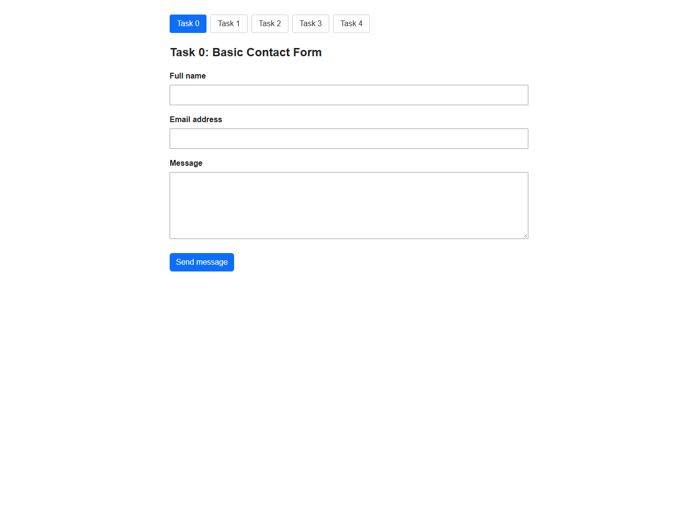
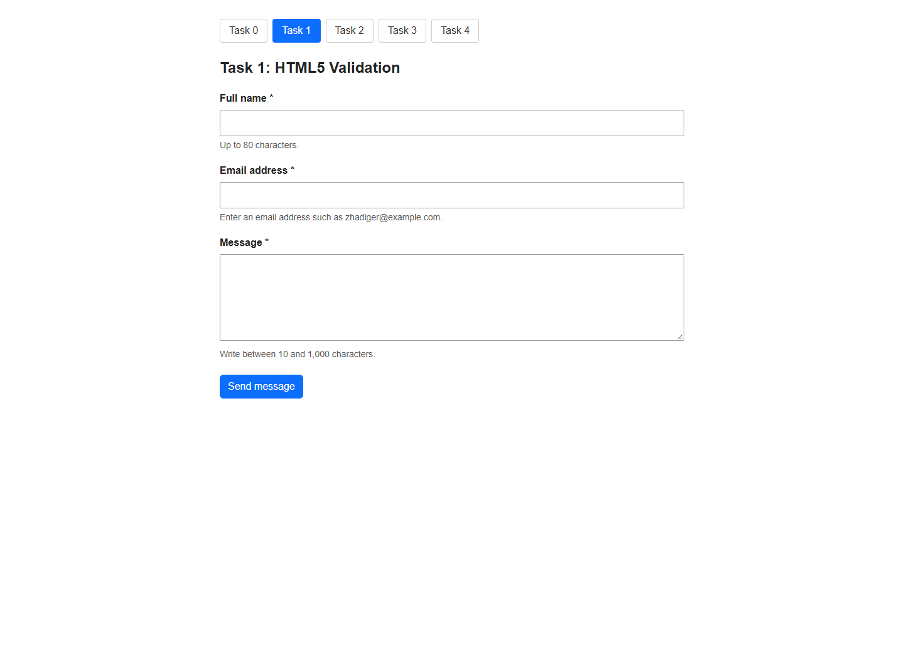
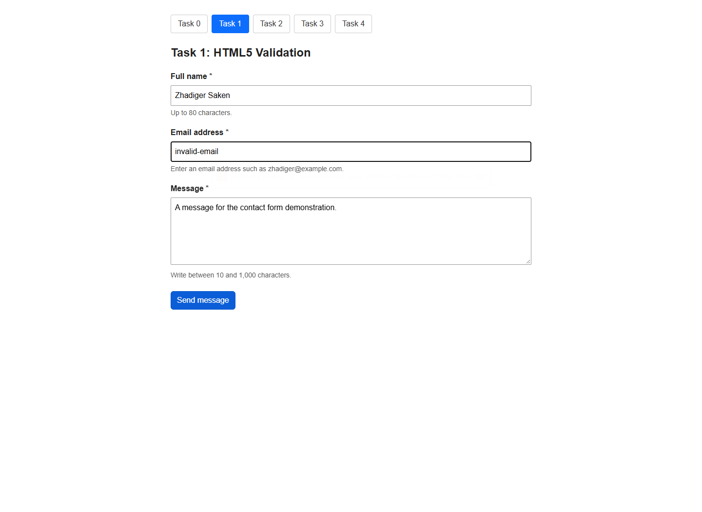
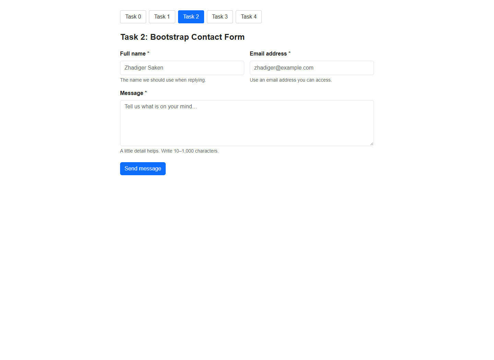
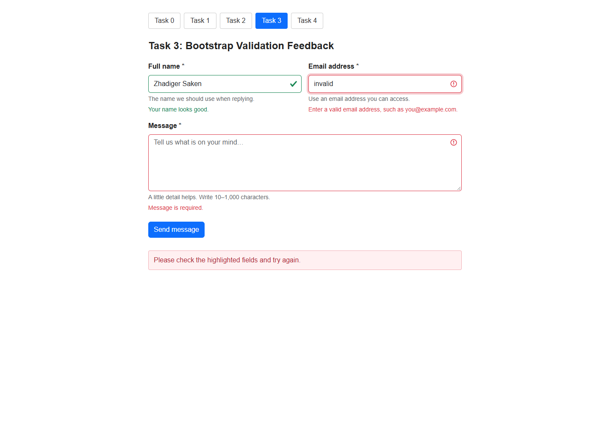
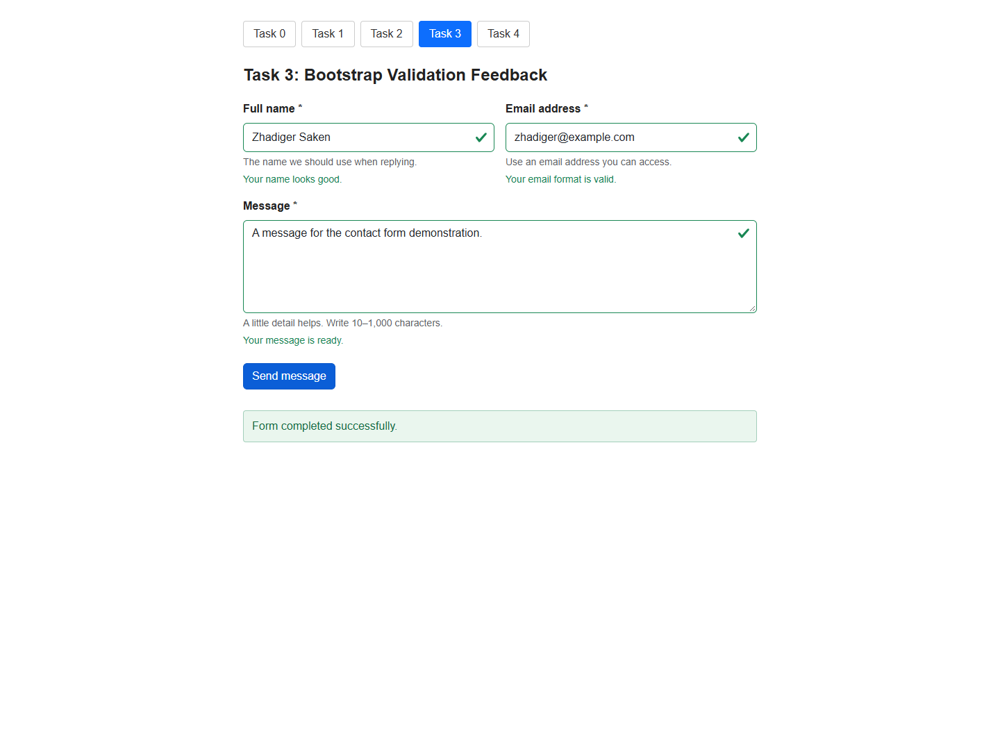
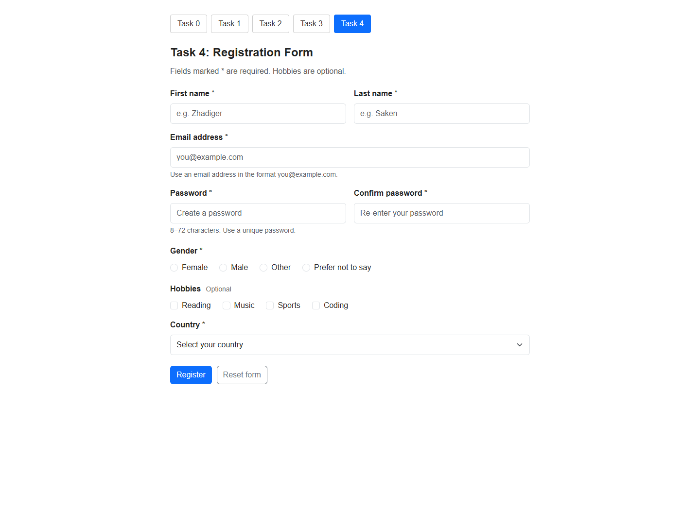
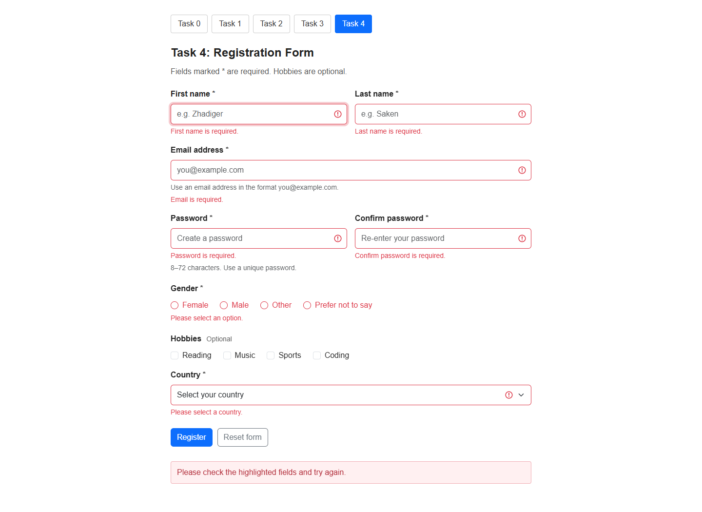
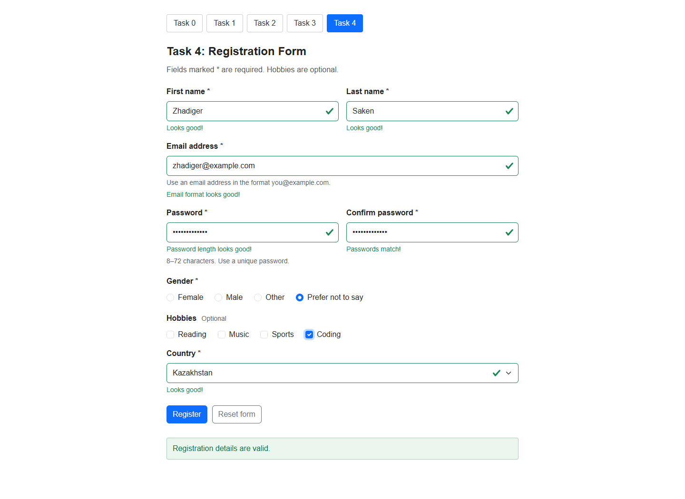
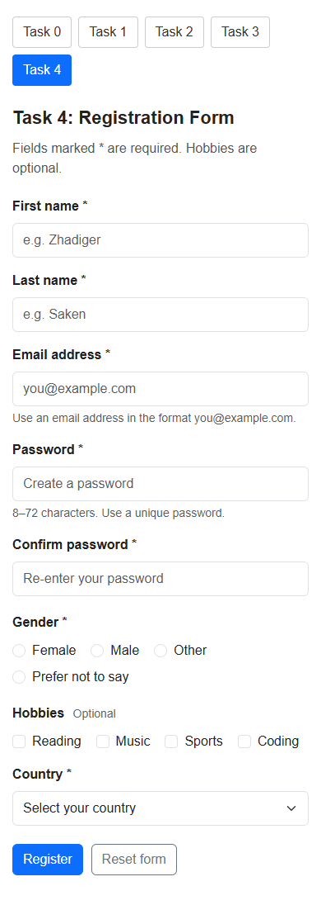

# Assignment 4: Forms and Validation

**Student:** Zhadiger Saken  
**Group:** SE-2538  

This project demonstrates a progression from a basic HTML contact form to a responsive registration form. It uses HTML5 controls and constraints, Bootstrap 5.3.3 form classes and grid columns, a simple Arial layout, and plain JavaScript for inline validation. Each page has top task navigation, one task heading, and its form. The pages use a 16px base font size and standard Bootstrap controls. Student attribution and group information appear in this report; form examples use Zhadiger Saken.

## Project structure

```text
assignment4-frontend/
├── README.md
├── dist/
│   ├── index.html                 # Task 4: registration form; main page
│   ├── task0.html                 # Basic contact form
│   ├── task1.html                 # Native HTML5 validation
│   ├── task2.html                 # Bootstrap form styling
│   ├── task3.html                 # Bootstrap validation feedback
│   └── assets/
│       ├── app.js                 # Validation, feedback, password matching, reset
│       └── styles.css             # Simple Arial styling and responsive layout
└── screenshots/                  # Screenshots used in this report
```

The files in `dist/` are the editable source and runnable website. There is no separate compilation step.

## Part 1. Basic HTML Forms

### Task 0. Simple Contact Form

**Page:** [`dist/task0.html`](dist/task0.html)

The form contains a name text input, an email input, a multiline message `<textarea>`, and a submit button. Every field has a visible `<label>` whose `for` attribute matches the control's `id`. Clicking a label focuses its field. Task 0 keeps the controls simple; the additional required-field and length rules are introduced in Task 1.



### Task 1. Form with HTML5 Validation

**Page:** [`dist/task1.html`](dist/task1.html)

All three contact fields use `required`. The email control uses `type="email"`. The name has an 80-character maximum, the email a 254-character maximum, and the message requires 10–1,000 characters. These attributes are evaluated by the browser; this form retains native validation tooltips.

Try submitting the empty form, then enter a name and a message while using `zhadiger` as the email. Submission is blocked until the native constraints pass. The precise tooltip wording depends on the browser and its language.





## Part 2. Bootstrap Forms

### Task 2. Bootstrap Form Styling

**Page:** [`dist/task2.html`](dist/task2.html)

This version uses Bootstrap's `form-label`, `form-control`, `form-text`, and button classes. The form is a `row g-3`; name and email use `col-md-6`, while the message spans the full row. The two columns stack on smaller screens. Placeholders show example entries, and helper text explains the input requirements. The native HTML5 validation rules remain enabled.



### Task 3. Bootstrap Validation Styles

**Page:** [`dist/task3.html`](dist/task3.html)

The contact form adds `valid-feedback` and `invalid-feedback` messages below each field. JavaScript evaluates the HTML5 constraints and applies `is-valid` or `is-invalid` to the controls. The form uses `novalidate` so the browser's tooltip does not interrupt the custom inline feedback.

Submitting incomplete or incorrectly formatted entries shows errors and focuses the first invalid control. Once a field has been checked, its feedback updates as it is edited. Correcting the values and submitting displays green states and a demonstration success message.





## Part 3. Advanced Form Project

### Task 4. Registration Form

**Page:** [`dist/index.html`](dist/index.html)

The final form includes first name, last name, email, password, confirmation, gender radio buttons, optional hobby checkboxes, a country dropdown, and submit and reset buttons. Bootstrap columns place related fields together on wider screens and stack them on phones.

The required fields use HTML5 constraints. Passwords require 8–72 characters. A JavaScript comparison uses `setCustomValidity()` to reject a confirmation that differs from the password. Whitespace-only first and last names are also rejected. Gender requires one radio selection: a missing selection shows red error feedback, which clears when an option is selected. Gender has no green success state or success message. The country placeholder has an empty value so a country must be chosen. Hobbies may be left unchecked or multiple choices may be selected.

The site has no password generator; the assignment requires password validation, not generation. HTML length constraints and the JavaScript confirmation check validate the entered values. Because the password fields use `autocomplete="new-password"`, the browser may independently suggest a generated password through its own password manager. See [MDN's autocomplete reference](https://developer.mozilla.org/en-US/docs/Web/HTML/Reference/Attributes/autocomplete#new-password).

Inline feedback explains errors and accepted values. Password inputs mask their contents. Reset restores the initial controls and removes validation classes, custom errors, and status messages. Labels, grouped controls, descriptive feedback associations, keyboard focus styles, a skip link, and a live status region support navigation and understanding.









## Work process

The implementation began with labeled HTML controls, then added native validation constraints. The next stage introduced Bootstrap form styling, helper text, and responsive columns. Shared JavaScript was added to show inline feedback while continuing to use the browser's constraint-validation API. The registration form combined these pieces and added matching passwords, radio and checkbox groups, a select control, and a full reset. The final stage checked the valid and invalid states, navigation, and layout, and collected the screenshots above.

## Validation and demonstration checklist

These examples can be repeated during the defense. Use test data rather than a real account password.

| Page / feature | Demonstration | Expected result |
| --- | --- | --- |
| Task 0 labels | Click the Name, Email, and Message labels | The corresponding control receives focus. |
| Task 1 required fields | Submit the empty form | The browser blocks submission and identifies a required field. |
| Task 1 email | Enter a name, `zhadiger` as email, and a message of at least 10 characters | The browser rejects the email format. |
| Task 1 message length | Type a message shorter than 10 characters, then submit | The browser rejects the short message. |
| Task 2 grid | Reduce the browser width below the medium breakpoint | Name and email stack vertically. |
| Task 3 invalid state | Enter a name, use `zhadiger` as email, and leave the message empty | The name is valid; email and message show inline errors. |
| Task 3 valid state | Use `Zhadiger Saken`, `zhadiger@example.com`, and `Hello, this is my test message.` | Green feedback and a demonstration success message appear. |
| Task 4 required fields | Submit an empty registration | Missing fields are highlighted; focus moves to the first error. |
| Task 4 name | Enter only spaces as a first or last name | A custom error asks for a meaningful value. |
| Task 4 password length | Type `short` as the password | The minimum-length constraint rejects it. |
| Task 4 confirmation | Enter two different passwords | The confirmation reports that passwords must match. |
| Task 4 password edits | Match the passwords, then change the first password | Confirmation is checked again and becomes invalid. |
| Task 4 choices | Leave gender and country unselected, then submit | Both required selections show errors. |
| Task 4 gender correction | Select a gender after the missing-selection error | The red error clears; no green success state or success message appears for gender. |
| Task 4 hobbies | Select multiple hobbies, or leave them all unchecked | Both choices are accepted; hobbies are optional. |
| Task 4 valid state | Use the sample values below and submit | A valid-registration message appears; no account is created. |
| Task 4 reset | After errors or a successful attempt, click Reset form | Values, feedback, and status return to the initial state. |
| Keyboard and mobile | Navigate with Tab and resize the page | Controls remain reachable and the layout fits the available width. |
